# Clipdeck

<p align="center">
  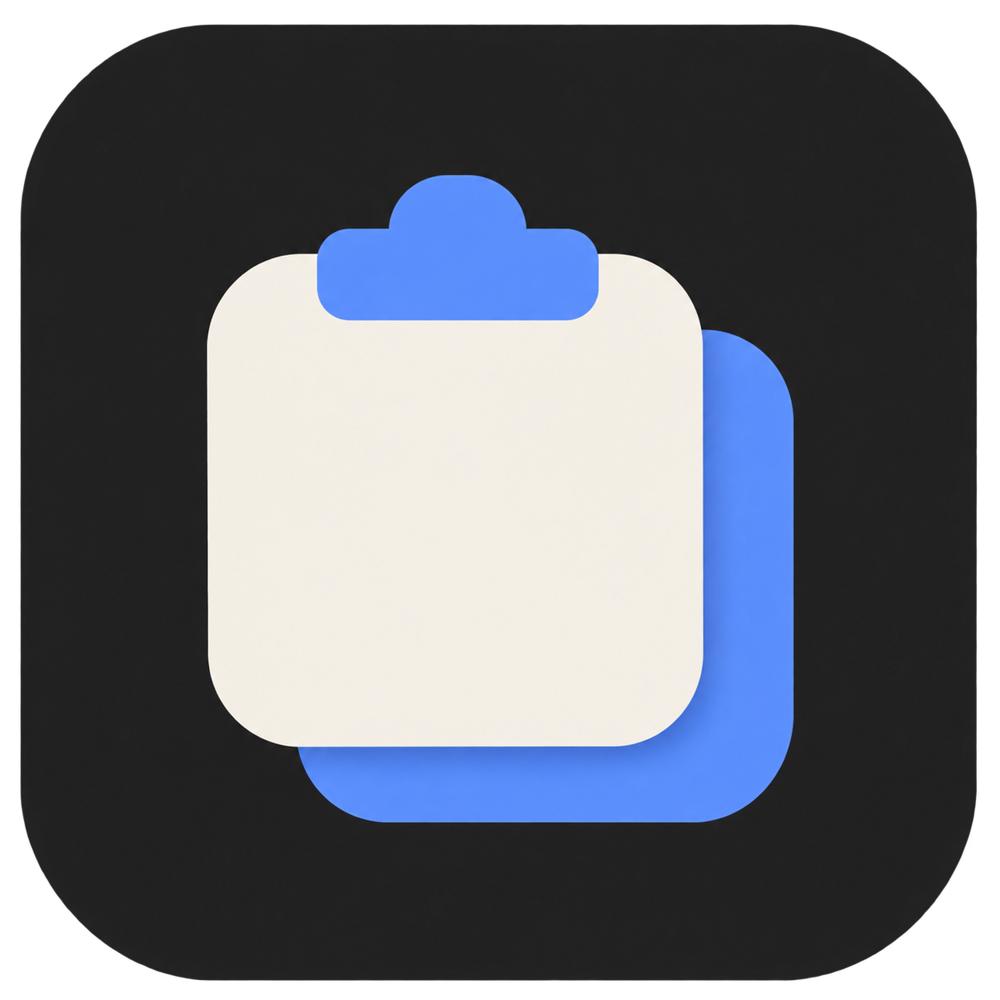
</p>

**A keyboard-first clipboard history for Windows.** Press <kbd>Ctrl</kbd>+<kbd>Shift</kbd>+<kbd>V</kbd>,
type a few letters, press <kbd>Enter</kbd>, and the clip lands in the app you were using.
Text, links, screenshots and whole file selections, searchable and one keystroke away.

Native Rust on [GPUI](https://github.com/zed-industries/zed/tree/main/crates/gpui), stored locally in SQLite,
with no telemetry. Update checks use GitHub; clipboard contents stay on your PC.

<p align="center">
  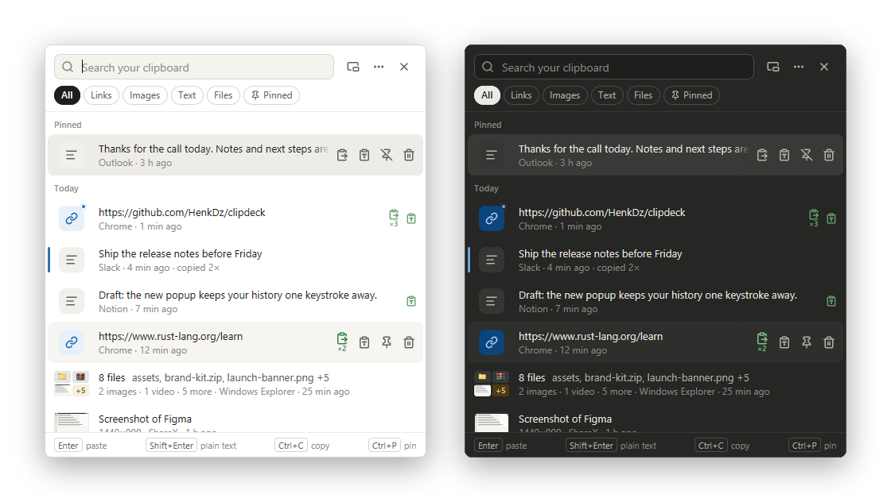
</p>

## Highlights

- **Search first.** The popup opens at your cursor with the search box focused. Results
  filter as you type; chips narrow to Links, Images, Text, Files or Pinned.
- **Paste where you were.** <kbd>Enter</kbd> pastes into the window that was active before the
  popup, <kbd>Shift</kbd>+<kbd>Enter</kbd> pastes as plain text, <kbd>1</kbd>–<kbd>9</kbd> paste
  the nth clip.
- **Every kind of clip.** Text with its rich formatting, links, email addresses, screenshots
  (titled with the captured app when ShareX saved it) and multi-file copies
  from Explorer, shown as one row with a thumbnail mosaic.
- **Actions on the row.** Hover or select a clip for paste, plain text, pin and delete.
  A green paste icon with ×N shows what you have already used.
- **Drag clips out.** Drag any row into another app: text, images (as a file and as image data)
  or files. Drag a single file out of a multi-file clip.
- **Your window, your way.** Comfortable or compact rows, resize from any edge, or keep the
  popup open on top while you paste into another app.
- **Private by default.** Copies flagged by password managers are never recorded, and nothing
  leaves your PC.
- **Light and dark**, following your Windows theme.

## A quick tour

### The list

Pinned clips stay on top, then Today and Earlier. Each row shows what the clip is, where it came
from and when. A blue bar marks clips you copied more than once; a blue dot marks the one on the
clipboard right now.

<p align="center">
  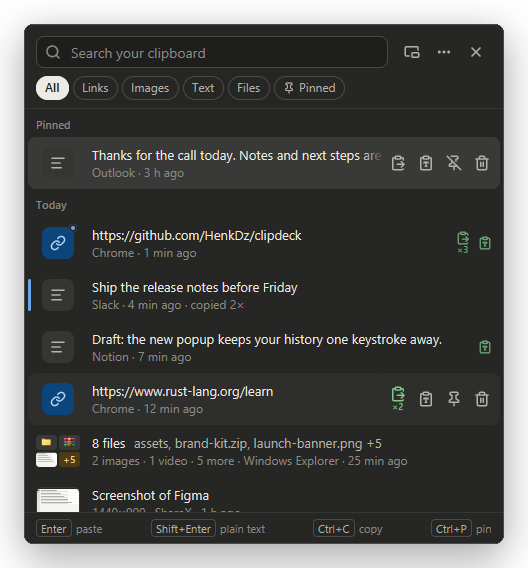
  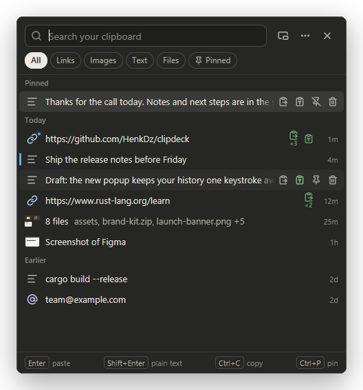
</p>
<p align="center"><sub>Comfortable and compact density (<kbd>Ctrl</kbd>+<kbd>D</kbd>)</sub></p>

### Files and screenshots

A copy of several files is one clip: "8 files · assets, brand-kit.zip, launch-banner.png +5",
with a type breakdown ("2 images · 1 video · 5 more"). <kbd>Space</kbd> opens a gallery of every
file; paste all of them, or just one. Missing files are marked.

<p align="center">
  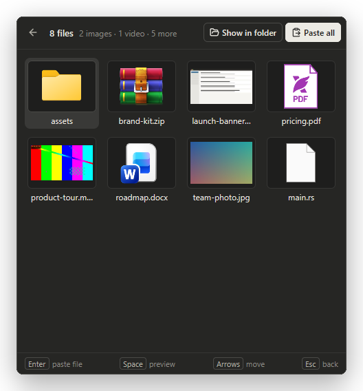
  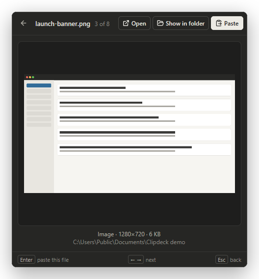
</p>
<p align="center">
  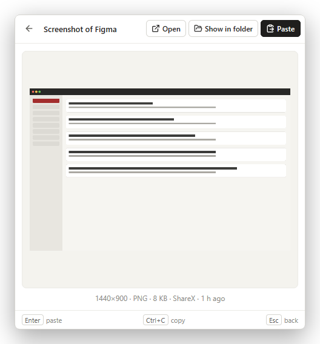
</p>

### Right-click for everything else

Paste as plain text, UPPERCASE, lowercase, trimmed or on one line; for files, paste the paths
or names as text, only the images, or one file. Show in folder, open in the default app, edit
text, pin, delete, copy without pasting, and clip details.

<p align="center">
  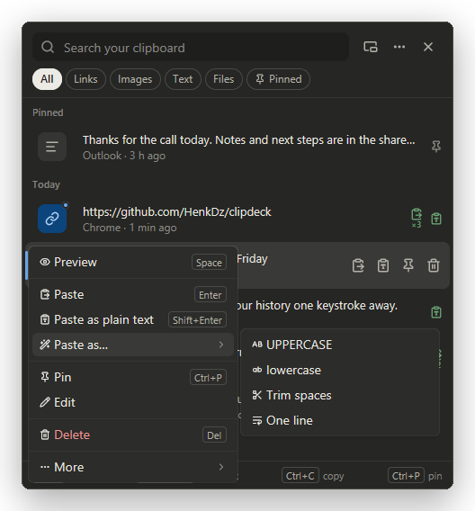
  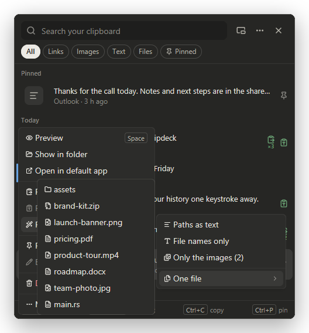
</p>

### Settings

No config files to edit. Change the shortcut by pressing the new keys, choose the density, keep
the window on top, and set how many clips to keep, the largest clip to record and the paste delay.
Changes apply immediately.

<p align="center">
  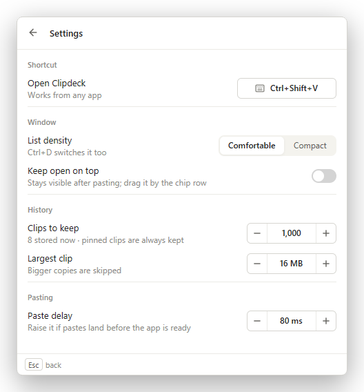
  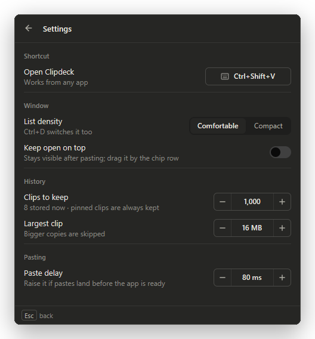
</p>

## Keyboard shortcuts

| Keys | Action |
| --- | --- |
| <kbd>Ctrl</kbd>+<kbd>Shift</kbd>+<kbd>V</kbd> | Open Clipdeck (change it in Settings) |
| Type | Search |
| <kbd>↑</kbd> <kbd>↓</kbd> | Move the selection |
| <kbd>Enter</kbd> | Paste |
| <kbd>Shift</kbd>+<kbd>Enter</kbd> | Paste as plain text |
| <kbd>1</kbd>–<kbd>9</kbd> | Paste the nth clip (search box empty) |
| <kbd>Ctrl</kbd>+click | Toggle a clip in the selection |
| <kbd>Shift</kbd>+click / <kbd>Shift</kbd>+<kbd>↑</kbd>/<kbd>↓</kbd> | Select a range |
| <kbd>Ctrl</kbd>+<kbd>C</kbd> | Copy selected clips without pasting |
| <kbd>Space</kbd> | Preview (file gallery for file clips) |
| <kbd>Ctrl</kbd>+<kbd>P</kbd> | Pin or unpin |
| <kbd>Del</kbd> | Delete |
| <kbd>Tab</kbd> / <kbd>Shift</kbd>+<kbd>Tab</kbd>, <kbd>Ctrl</kbd>+<kbd>1</kbd>–<kbd>6</kbd> | Switch filter |
| <kbd>Ctrl</kbd>+<kbd>D</kbd> | Comfortable / compact rows |
| <kbd>Ctrl</kbd>+<kbd>,</kbd> | Settings |
| <kbd>Esc</kbd> | Back, or close the popup |

In the file gallery: arrows move, <kbd>Enter</kbd> pastes that one file, <kbd>Space</kbd> opens
its preview. While editing a clip, <kbd>Ctrl</kbd>+<kbd>S</kbd> saves.

In the history list, Enter, Ctrl+C, Ctrl+P and Delete act on the selected clips.
Selected images and files become one file-attachment batch, in list order; selected text
is joined with line breaks. Text and files cannot be combined in one batch. Right-click
a selected row for the bulk actions. Search, filter changes and reopening start a fresh selection.

## Getting started

### Download

Get `clipdeck-0.1.4-windows-x64.zip` from the
[latest release](https://github.com/HenkDz/clipdeck/releases/latest), unzip it anywhere and run
`clipdeck.exe`. There is no installer; your history and settings live in `%APPDATA%\Clipdeck`.

- Windows 10 or 11, 64-bit. It uses the Microsoft Visual C++ runtime, which most PCs already
  have; if Windows reports `VCRUNTIME140.dll` missing, install the
  [Visual C++ Redistributable](https://aka.ms/vs/17/release/vc_redist.x64.exe).
- The exe is not code-signed yet, so SmartScreen may warn on first launch: choose
  **More info → Run anyway**.

Clipdeck runs in the background with a tray icon:

- **Left-click** the tray icon to open the popup (click again to close it).
- **Right-click** for Open, Pause recording, Settings and Quit.
- Starting it a second time just opens the running copy.

### Updates

Choose **Check for updates** from the tray menu or Settings. Clipdeck shows the new
version and release notes, downloads and verifies it, then offers **Update and restart**.
Daily background checks are optional and off by default. The app folder must be writable.

v0.1.1 and earlier need one manual upgrade to v0.1.4 to gain the updater. Your history
and settings remain in `%APPDATA%\Clipdeck`. Updates use a signed manifest and SHA-256
checksums. Before replacement, Clipdeck closes and makes a consistent history backup.
If the new version fails before startup completes, it restores the previous executable
and history. Recovery files are kept under `%LOCALAPPDATA%\Clipdeck\updates` and beside
the executable. Keep recovery files until the upgraded version has been checked.

### Build from source

**Requirements:** [Rust](https://rustup.rs) with the MSVC toolchain (Visual Studio Build Tools
with "Desktop development with C++" and the Windows SDK). The SDK resource compiler embeds
the icon and version metadata. The repository pins Rust 1.99.1 in `rust-toolchain.toml`;
rustup installs it on the first build.

```powershell
git clone https://github.com/HenkDz/clipdeck.git
cd clipdeck
cargo build --release
.\target\release\clipdeck.exe
```

The first build compiles GPUI and takes a few minutes.

## Privacy and data

- Clips stay on your PC in `%APPDATA%\Clipdeck\history.db` (SQLite). Network requests are
  used for GitHub update checks and downloads; clipboard contents are never uploaded.
- Copies marked private by their source app are never stored: the clipboard flags
  `ExcludeClipboardContentFromMonitorProcessing`, `CanIncludeInClipboardHistory = 0` and
  `Clipboard Viewer Ignore`, which password managers set.
- Pause recording from the tray at any time.
- Clipdeck reads the clipboard briefly and only after the copying app has finished, so it does
  not get in the way of other apps' copies (or other clipboard managers).
- Settings are saved to `%APPDATA%\Clipdeck\config.toml`; you never need to open it.

## How it's built

| Part | Choice |
| --- | --- |
| UI | [GPUI](https://github.com/zed-industries/zed/tree/main/crates/gpui) via `gpui-component` 0.9, Lucide icons |
| Clipboard listener | `AddClipboardFormatListener` on a message-only window |
| Paste | Restore the previous window, write the clip, send <kbd>Ctrl</kbd>+<kbd>V</kbd> with `SendInput` |
| Drag out | The Shell's data object and drag loop (`SHCreateDataObject`, `SHDoDragDrop`) |
| Storage | SQLite with FTS5 trigram search (`rusqlite`, bundled) |
| Thumbnails | Windows Shell thumbnails and icons for files; PNG for images |
| Global shortcut, tray | `global-hotkey`, `tray-icon` |

All Windows-specific code lives in [`src/platform`](src/platform); the UI never touches raw
handles. The product spec is in [`docs/SPEC.md`](docs/SPEC.md) and the visual reference in
[`docs/mockup.html`](docs/mockup.html).

## Development

```powershell
cargo fmt --check
cargo clippy --all-targets -- -D warnings
cargo test

# With Clipdeck stopped: opt-in tests that use the real clipboard
# and read your ShareX history (read-only)
cargo test -- --ignored --test-threads=1
```

Build notes, design decisions and desktop verification records are in
[`docs/MILESTONE2_NOTES.md`](docs/MILESTONE2_NOTES.md).

## Roadmap

Done: the clipboard spike (milestone 1) and the full app (milestone 2), including the settings
screen and drag out. Next (milestone 3):

- Import history from Ditto
- Collections
- Masking and auto-expiry for password-like text
- Start with Windows
- A paste queue: copy several items, paste them in order
- Smart actions by type: clean tracking parameters from links, format JSON, convert colors
- A list of apps whose copies are never recorded
- Multi-select and paste joined clips
- Undo for delete
- Search filters such as `app:chrome`, `type:image`, `today`
- Source app icons

## Acknowledgements

[Ditto](https://github.com/sabrogden/Ditto) is the reference for Windows clipboard behavior and
edge cases; Clipdeck shares no code with it. Icons are from [Lucide](https://lucide.dev),
bundled through `gpui-kit-assets`.

## License

No license has been chosen yet. Until one is added, all rights are reserved.
